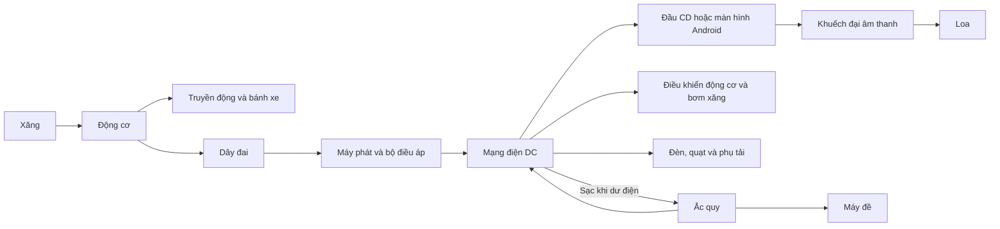

# Yaris mua năm 2008: điện, âm nhạc và màn hình 16 triệu đồng

Ngày tra cứu: **08/10/2026**. Người dùng chưa biết mã màn hình, có ampli/sub thêm hay không, và xe tắt khi đang chạy hay không đề được sau khi đỗ. Vì vậy kết quả là phân tích theo kịch bản, chưa phải chẩn đoán chiếc xe.

## 1. Trả lời trực tiếp bài toán

Màn hình nghe YouTube có dùng điện và tạo thêm tải cho hệ thống. Tuy nhiên, **giá 16 triệu đồng không xác định được tải điện, cũng không chứng minh nó gây chết máy**. Khi thay đầu cũ, phải tính chênh lệch giữa hai đầu ở cùng điều kiện, cộng thêm thiết bị thực sự lắp mới.

Trong ví dụ của code, đầu CD tiêu thụ 26,18 W, Android nghe vừa 43,18 W. Phần tăng chỉ **17 W**, tương đương **1,21 A ở 14 V**. Với máy phát khỏe và đủ tải, mức tăng này có thể nằm trong khả năng cấp điện. Khi có ampli/sub lớn, tải có thể thay đổi rất nhiều: kịch bản riêng trong code lên 578,32 W.

Chưa có cơ sở yêu cầu nâng cấp máy phát. Cần xác định đúng xe/máy phát, đo tải khi máy nóng và không tải, kiểm tra bình và đấu dây, rồi mới quyết định. Một bộ máy phát bị hỏng, dây sạc có điện trở cao, hoặc màn hình không ngủ khi khóa xe cần được sửa đúng nguyên nhân.

## 2. Xác định xe và sửa cách hiểu thông số

“1.8” thường là **dung tích**, không phải công suất. Tài liệu Yaris SR 1.8 ghi 1.798 cc, 133 DIN hp, dài 3,8 m, năm dây đai và khoang hành lý 272–363 lít. “Không cốp” có thể nghĩa là không có cốp tách rời. Năm mua chưa xác nhận phiên bản; cần đối chiếu đăng ký. [Toyota: hồ sơ Yaris SR](https://media.toyota.co.uk/wp-content/uploads/sites/5/pdf/Gen2-Yaris-SR-archive-press-pack.pdf).

Không được suy ra máy phát nhỏ chỉ vì thân xe nhỏ, hoặc suy ra dòng máy phát từ dung tích động cơ. **80 A trong code là giả định để thử**, không phải thông số đã tra đúng chiếc Yaris của gia đình. Số chỗ ngồi cũng không quyết định công suất máy phát.

## 3. Máy phát và ắc quy làm gì?

Máy phát nhận chuyển động từ động cơ qua dây đai, đổi cơ năng thành điện, cấp các tải và nạp lại bình. Khi tải vượt khả năng phát, bình bù phần thiếu. [DENSO: nguyên lý hệ thống, trang 42](https://assets.denso-am.eu/production/attachments/Starter-Alternator-Manual-English.pdf).



Sơ đồ là mô hình khái niệm: máy phát và bình cùng nối mạng điện qua dây/cầu chì; điện không bắt buộc phải đi vào bình rồi mới đi tới màn hình.

Ắc quy tích trữ điện; máy đề lấy điện lúc khởi động. Khi tắt động cơ mà nghe nhạc, điện chủ yếu lấy từ bình. Khi động cơ chạy nhưng điện thiếu, bình vẫn có thể bị xả. Vì vậy nói bình “chỉ để khởi động” bỏ sót vai trò cấp tải lúc động cơ tắt và bù điện.

Năng lượng điện cuối cùng đến từ xăng qua nhiều lần chuyển đổi, không miễn phí khi xe đang chạy. Trong mô hình này, động cơ đang nổ tại chỗ vẫn có thể phát điện; không cần bánh xe quay. Khả năng phát phụ thuộc tốc độ máy phát và nhiệt độ, không chỉ tốc độ xe.

## 4. Đầu đĩa, đầu số và thông tin thị trường

Đầu CD dùng đĩa làm nguồn dữ liệu, rồi giải mã, đổi sang tín hiệu âm thanh và khuếch đại ra loa. Đầu số không đĩa đọc Bluetooth/USB hoặc ứng dụng. Android còn có màn hình, bộ xử lý, mạng và phần mềm; YouTube cần kết nối dữ liệu và giải mã. Bỏ cơ cấu quay đĩa không bảo đảm tổng điện giảm vì thiết bị mới có thêm chức năng.

Toyota ghi bản SR 1.8 có đầu CD/MP3/WMA và sáu loa. Đây chỉ là ví dụ cấu hình xuất xưởng, chưa xác định đầu cũ trên chiếc xe đang xét. [Toyota: trang 34](https://media.toyota.co.uk/wp-content/uploads/sites/5/pdf/Gen2-Yaris-SR-archive-press-pack.pdf).

| Ví dụ có nguồn hãng | Thông tin công bố | Ý nghĩa đối với bài toán |
|---|---|---|
| Zestech ZT12.3 tiêu chuẩn | Bài đăng 14/03/2024 liệt kê 16.000.000 đồng | Chứng minh có sản phẩm ở mức giá được mô tả; không xác nhận thiết bị gia đình |
| Sony XAV-AX4000/4050 | 20 W RMS × 4 ở 4 Ω, tối đa quảng bá 55 W × 4; dòng tiêu thụ định mức 10 A | Công suất ra loa khác công suất điện đầu vào; số định mức khác dòng thực khi nghe vừa |

Nguồn: [bảng giá trong bài Zestech](https://zestech.vn/tin-tuc/hung-lam-kham-pha-man-hinh-android-zestech.html), [thông số chính hãng Sony](https://helpguide.sony.net/ev/xav-ax40/v1/en/contents/TP1000661344.html).

Giá trên là **giá ghi trong bài lịch sử**, không phải báo giá lắp đặt hiện tại ngày 08/10/2026. Không dùng nó để đánh giá chi phí mua mới. Sony là thiết bị minh họa cách đọc thông số, không phải thiết bị đã xác định trên xe.

Giá bán có thể bao gồm màn hình, xử lý, phần mềm, camera, bảo hành và lắp đặt. Muốn đánh giá điện phải hỏi mã model, điện áp, dòng định mức, dòng khi hoạt động/ngủ, loại ampli và thiết bị đi kèm. Số “4 × 50 W” hoặc DSP nhiều kênh không tự cho biết bao nhiêu W lấy từ bình. Cầu chì cũng không phải đồng hồ công suất.

## 5. Nhạc nhẹ có luôn tốn điện ít hơn nhạc mạnh?

**Không thể kết luận từ thể loại.** Công suất điện đưa vào loa phụ thuộc mức tín hiệu, âm lượng, EQ/bass, trở kháng và hiệu suất khuếch đại.

Với mô hình loa là điện trở cố định:

```text
P_loa_trung_bình = trung_bình(v(t)^2) / R = V_RMS^2 / R
P_đầu_vào = P_điện_tử + P_loa_trung_bình / hiệu_suất_ampli
```

Đây là xấp xỉ: loa thật có trở kháng thay đổi theo tần số và pha. Công suất trên là công suất điện vào loa, không phải công suất âm phát ra không khí.

Ở cùng chuỗi thiết bị và gain, tăng biên độ tín hiệu gấp đôi làm công suất theo mô hình tăng bốn lần. Nhạc có tín hiệu trung bình cao hơn tại cùng gain có thể tiêu thụ nhiều hơn. Nhưng bản nhạc nhẹ bật lớn có thể tốn hơn bản nhạc mạnh bật nhỏ. Nếu trình phát tự chuẩn hóa âm lượng, tương quan cũng có thể thay đổi.

Code có `--wav` để tính RMS, đỉnh mẫu và crest factor từ WAV PCM 16-bit. Tỷ số bình phương RMS giúp so sánh tín hiệu ở cùng điều kiện; nó **không chuyển trực tiếp thành dòng bình** nếu chưa hiệu chuẩn hệ thống. WAV có khoảng im lặng được tính trong trung bình; stereo tính tất cả kênh. Không có file nhạc thật nên dự án chưa đưa ra tỷ lệ tiêu thụ cho hai bài cụ thể.

Kịch bản “Android vừa/lớn” là giả định công suất loa tổng 10/40 W. Đây là hai mức tải, không phải hai thể loại hay hai bài đã đo.

## 6. Những tải điện nào cần đưa vào phép tính?

Bảng sau là **bộ số giả định nhất quán**, không phải công suất nhà máy Yaris. Thay bằng dòng đo hoặc tài liệu đúng mã xe khi có.

| Tải ngoài đầu nghe nhạc | Ban ngày (W) | Ban đêm + quạt (W) |
|---|---:|---:|
| ECU, đánh lửa, phun xăng, bơm xăng quy gộp | 120 | 120 |
| Đèn | 0 | 140 |
| Quạt gió cabin | 40 | 100 |
| Quạt làm mát quy theo trạng thái xét | 0 | 80 |
| Phụ tải khác | 20 | 20 |
| **Tổng** | **180** | **460** |

Tải có thể đóng/ngắt, có xung khởi động hoặc biến thiên khi đánh lái. Mô hình trạng thái cố định chưa mô phỏng xung này. Máy nén điều hòa cơ khí không được cộng toàn bộ thành W điện; quạt và phần điều khiển điện mới nằm trong bảng. Tổng này loại trừ cả đầu cũ và đầu mới, tránh cộng trùng.

| Thông số khác | Giả định trong code |
|---|---|
| Điện áp khi động cơ chạy | 14 V |
| Máy phát danh định | 80 A; khảo sát thêm 60/100 A |
| Hệ số nhiệt | 0,85 |
| Hệ số tốc độ | 1 khi chạy, 0,4 khi không tải; khảo sát 0,3/0,6 |
| Mục tiêu dòng sạc bình | 6 A |
| Dự phòng thiết kế | 15% khả năng phát sau giảm tải |
| Điện tử CD / Android | 8 / 25 W |
| Hiệu suất ampli tích hợp / ngoài | 55% / 85% |
| Bình | 45 Ah, dung lượng còn 70%, SOC ban đầu 85% |
| Mốc dự phòng tính thử | SOC 60%; không phải ngưỡng bảo đảm đề |
| Hiệu suất máy phát / gia tăng động cơ | 55% / 22% |
| Tốc độ trung bình khi di chuyển | 20 km/h |

Hiệu suất ampli cố định chỉ là mô hình đơn giản; nó thay đổi theo mức tín hiệu. Hệ số không tải/nhiệt là cách khảo sát, không thay thế đường cong dòng theo vòng tua của máy phát thật. Không có con số nào trong bảng này được coi là số đo chiếc xe.

## 7. Công thức và kết quả tải điện

```text
P_âm_thanh = P_điện_tử + P_loa / η_ampli + P_ampli_ngoài_nghỉ + P_loa_ngoài / η_ngoài
I_máy_phát_khả_dụng = I_danh_định × hệ_số_tốc_độ × hệ_số_nhiệt
P_khả_dụng = điện_áp × I_khả_dụng
Dư_trước_sạc = P_khả_dụng − P_tải_xe − P_âm_thanh
P_bình_bù = max(0, −Dư_trước_sạc)
P_có_thể_sạc = max(0, min(Dư_trước_sạc, điện_áp × dòng_sạc_mong_muốn))
```

Dự phòng 15% chỉ dùng để xét thiết kế, không phải một thiết bị tiêu thụ điện. Thiếu mục tiêu sạc không đồng nghĩa với xả bình. Ví dụ còn dư 10 W nhưng muốn sạc 84 W: bình có thể nhận tối đa 10 W theo ngân sách này, không phải đang mất 74 W.

Các kết quả dưới đây được đối chiếu với [bảng tự sinh](KET_QUA.md):

| Kịch bản | Điện âm thanh (W) | Tổng tải (W) | Máy phát khả dụng (W) | Dư trước sạc (W) |
|---|---:|---:|---:|---:|
| Chạy ban đêm, CD | 26,18 | 486,18 | 952,00 | +465,82 |
| Chạy ban đêm, Android vừa | 43,18 | 503,18 | 952,00 | +448,82 |
| Chạy ban đêm, Android lớn | 97,73 | 557,73 | 952,00 | +394,27 |
| Không tải ban đêm, CD | 26,18 | 486,18 | 380,80 | −105,38 |
| Không tải ban đêm, Android vừa | 43,18 | 503,18 | 380,80 | −122,38 |
| Chạy ban đêm, ampli/sub lớn | 578,32 | 1.038,32 | 952,00 | −86,32 |

Trong giả định này, Android vừa không làm thiếu điện khi chạy. Lúc không tải tải lớn, **cả CD cũ cũng đã thiếu điện**; đầu mới chỉ tăng thiếu hụt 17 W. Không thể lấy thiếu hụt 122 W rồi quy toàn bộ cho màn hình.

Đứng đèn đỏ có thể xả tạm thời rồi sạc lại khi chạy; cần xét thời gian ở mỗi trạng thái và lượng sạc thực nhận của bình. Mô hình chưa tích phân hành trình hay điện lúc đề, nên không kết luận bình ngày càng cạn chỉ từ một trạng thái không tải.

Phép tính dòng danh định cần để đáp ứng tải, sạc và dự phòng:

```text
I_yêu_cầu = (P_tải_xe + P_âm_thanh + U × I_sạc) /
            [U × hệ_số_tốc_độ × hệ_số_nhiệt × (1 − dự_phòng)]
```

Con số này chỉ có ý nghĩa trong điều kiện đầu vào. Máy phát lớn hơn có thể có đặc tính không tải khác; không được giữ máy móc cùng hệ số 0,4 rồi coi kết quả là khuyến nghị mua.

## 8. Năng lượng và xăng trên 1 km

Dùng 8,9 kWh/lít làm nhiệt trị gần đúng để tính. Bảng AFDC cho năng lượng xăng theo khoảng thành phần; quy đổi Btu/gallon sang kWh/lít cho giá trị khoảng 8,7–9,0. [U.S. DOE/AFDC: bảng đặc tính nhiên liệu](https://afdc.energy.gov/fuels/properties?fuels=GS%2CETH%2CHY).

Toyota công bố bản SR 1.8 đạt 30,7 mpg đô thị và 39,2 mpg kết hợp trong chu kỳ thử thời đó. Dùng gallon Anh: `lít/100 km = 282,481 / mpg`, tương đương khoảng 9,20 và 7,21. Đây không phải mức tiêu thụ đo tại Việt Nam trên xe hiện tại. [Toyota: trang 30](https://media.toyota.co.uk/wp-content/uploads/sites/5/pdf/Gen2-Yaris-SR-archive-press-pack.pdf).

Chọn 9,2 lít/100 km làm mức nền minh họa:

```text
Năng_lượng_xăng_nền = 9,2 / 100 × 8,9 × 1000 = 818,8 Wh/km
Điện_âm_thanh = P_âm_thanh / tốc_độ_trung_bình                 [Wh/km]
Xăng_âm_thanh = P_âm_thanh / (1000 × η_máy_phát × η_động_cơ × 8,9) [lít/giờ]
Xăng_âm_thanh_trên_100km = Xăng_âm_thanh × 100 / tốc_độ       [lít/100 km]
```

818,8 Wh/km là **năng lượng hóa học trong xăng**, không phải điện của xe hoặc cơ năng ở bánh. Hai đại lượng không được so trực tiếp để suy ra tỷ lệ tiết kiệm mà bỏ qua hiệu suất.

| Âm thanh, ở 20 km/h | Điện (Wh/km) | Xăng quy cho cụm âm thanh (lít/100 km) | Tăng so CD (lít/100 km) |
|---|---:|---:|---:|
| CD cũ | 1,309 | 0,122 | 0 |
| Android vừa | 2,159 | 0,200 | 0,079 |
| Android lớn | 4,886 | 0,454 | 0,332 |

**Đổi đầu ở cùng công suất loa** trong giả định này tăng khoảng 0,079 lít/100 km, không phải tăng toàn bộ 0,200. Tăng từ nghe vừa lên lớn còn thay đổi công suất ra loa. Nếu mức nền đã gồm đầu CD thì chỉ cộng phần chênh lệch khi ước lượng mức mới; không cộng toàn bộ điện của xe thêm vào mức nhiên liệu vốn đã bao gồm các tải.

Ở 10–40 km/h và hiệu suất gia tăng động cơ 15–30%, phần tăng 17 W cho khoảng **0,029–0,232 lít/100 km**. Khoảng này khảo sát giả định, không phải khoảng tin cậy thống kê hay kết quả đo. Hiệu suất gia tăng phản ánh chi phí thêm tải; không đồng nhất với hiệu suất trung bình toàn động cơ.

Khi xe đứng yên, trên mỗi km không xác định: code trả `null`, dùng lít/giờ. Khi ắc quy đang bù, điện chưa hoàn toàn đến từ máy phát ngay lúc đó; kết quả xăng là ước lượng dài hạn nếu năng lượng ấy cuối cùng được nạp lại. Code chưa mô phỏng tổn hao nạp/xả, đặc tính ECU hay toàn hành trình.

## 9. Tắt máy nghe nhạc và dòng rò sau khi đỗ

```text
Năng_lượng_tới_mốc_dự_phòng = Ah × hệ_số_dung_lượng × V_bình × (SOC_đầu − SOC_dự_phòng)
                           = 45 × 0,7 × 12,6 × (0,85 − 0,60) = 99,225 Wh
Thời_gian_tới_mốc = năng_lượng / tổng_tải
```

Chỉ Android vừa: khoảng **2,30 giờ tới mốc SOC giả định**. Thêm tải phụ 100 W: khoảng **0,69 giờ**. Đây không phải thời gian nên nghe nhạc hay bảo đảm đề được: khả năng đề còn phụ thuộc dòng khởi động, nội trở, nhiệt độ, tuổi bình và tình trạng máy đề.

Nếu màn hình/thiết bị làm tăng dòng nghỉ 0,3 A liên tục, ba ngày mất thêm `0,3 × 72 = 21,6 Ah`. Giá trị 0,3 A là ví dụ, không phải dòng rò đã đo. Với ngân sách dự phòng đang giả định, bình tới mốc sau khoảng 26,25 giờ; ba ngày đã vượt mốc đó. Mô hình dòng rò không xét tự xả và dòng nghỉ sẵn có của xe.

Điều này giải thích vì sao thiết bị không ngủ hoặc đấu ACC sai có thể quan trọng hơn nhạc mạnh/nhẹ. Máy phát lớn hơn cũng không cấp điện cho xe khi động cơ đã tắt.

## 10. Cần đo gì để xác định nguyên nhân?

Trước hết phân biệt **động cơ đang chạy bị tắt**, **máy đề quay yếu/không quay**, và **máy đề quay bình thường nhưng động cơ không nổ**. Ba biểu hiện dẫn đến các nhánh kiểm tra khác nhau. Hết xăng và thiếu điện không bao quát mọi nguyên nhân; chưa có bằng chứng loại trừ lỗi khác.

Yêu cầu gara ghi bảng số đo, thay vì chỉ kết luận “màn hình ăn điện”:

1. Xác định mã xe/động cơ, tem máy phát, thông số bình, mã đầu mới và toàn bộ ampli/camera gắn thêm.
2. Kiểm tra bình bằng phép thử phù hợp; xem dây đai, dây sạc, cọc bình, tiếp mass và cầu chì.
3. Đo điện áp cùng dòng bình/máy phát khi máy nóng: không tải và khoảng 2.000 rpm, lần lượt tắt/bật đèn, quạt và màn hình; đối chiếu tiêu chuẩn đúng mã xe.
4. Đo dòng nhánh âm thanh ở cùng bài nhạc/âm lượng; ghi cả trung bình, đỉnh và thời gian đo. Đo khi tắt màn hình để có phép so sánh.
5. Sau khóa xe và chờ hệ thống ngủ theo quy trình đúng xe, đo dòng nghỉ; so sánh khi tách nhánh đầu mới bởi kỹ thuật viên.
6. Với tình trạng đang chạy bị tắt, đọc lỗi và kiểm tra cấp nhiên liệu/đánh lửa/điện điều khiển theo biểu hiện.

DENSO khuyến nghị kiểm tra bình, đường sạc, mass và dây đai, rồi đo điện áp/dòng ở điều kiện quy định; giá trị chuẩn phụ thuộc nhà sản xuất. Không tháo cọc bình khi động cơ đang nổ để thử máy phát. [DENSO: quy trình kiểm tra](https://www.denso-am.eu/news/alternator-troubleshooting).

**Chỉ cân nhắc nâng máy phát** khi máy phát hiện tại khỏe, dây/bình/đấu nối đã đúng, nhưng tải thực tế kéo dài vẫn vượt khả năng cấp điện và chu trình đi xe không bù được lượng xả. Chọn máy phát phải xét khả năng phát lúc không tải, cơ khí, dây đai, điều áp, đầu nối và dây/cầu chì; không chỉ số A lớn hơn.

## 11. Code được kiểm tra thế nào và còn thiếu gì?

Python chỉ dùng thư viện chuẩn. `yaris_power.py` chứa mô hình và CLI; `render_results.py` sinh lại bảng và JSON. Kiểm thử xác nhận phép tính độc lập bằng ví dụ tính tay, cân bằng năng lượng ở 300 tổ hợp ngẫu nhiên có seed, ranh giới thiếu điện/sạc chậm, đổi đầu có tải giảm, lỗi đầu vào và định dạng JSON. WAV được kiểm tra bằng mẫu tổng hợp có kết quả RMS biết trước.

Đã chạy **26 kiểm thử trên Python 3.11.9**, đều đạt. CI cấu hình thêm Python 3.12/3.13; chỉ gọi chúng đã đạt khi có kết quả GitHub thực tế. Chưa có đo xe, file nhạc thật hay mã màn hình, nên chưa kiểm chứng đầu vào vật lý.

Mô hình chưa mô phỏng điện áp sụt theo nội trở, xung bass, tuổi bình theo nhiệt, hiệu ứng Peukert, nhận sạc/tổn hao bình, đường cong máy phát theo rpm, quản lý tải ECU hoặc hành trình đóng/ngắt tải. Vì vậy nó xác định điều kiện cần kiểm tra, **không chứng minh nguyên nhân chết máy và không đưa ra chỉ định nâng cấp cho xe này**.

Kết luận thực dụng: từ giá 16 triệu và thể loại nhạc chưa suy ra được lỗi. Phần tăng điện của đầu mới có thể nhỏ khi nghe vừa; ampli lớn, thiếu phát ở không tải, bình/dây hỏng hoặc dòng rò là những nhánh cần đo để phân biệt.
